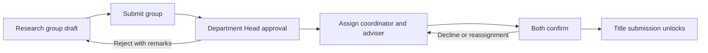

# SMS2 v3 migration and HostForge verification

Verified on 2026-10-14 in the cloud workspace, using PHP 8.2, Apache, and MariaDB 11.4 in disposable Docker containers. No live hosting database was changed and no deployment was published.

Reference: `khnny/sms2-capstone-v3` commit `1ed8eea264358aac0d7f27d77cbcaa46950af744`. The historical upgrade fixture was the original `sms2-capstone` database dump from commit `aa4d169`. Unpushed changes under `C:\xampp\htdocs\sms2-capstone-v3` are outside this verification.

## Results and fixes

| Finding reproduced or established from code | Fix and validation |
| --- | --- |
| Initial migration stopped with MariaDB error 1068, multiple primary keys on `sms2_security_otps`. | Removed the duplicate primary-key ALTER; clean installation now imports both dumps. |
| The SMS2 dump contained CRAD ALTERs before the CRAD base tables were installed. | Removed the duplicated CRAD appendix from the SMS2 dump. CRAD owns these definitions. |
| `--fresh` dropped the same shared database separately for each schema. | Drop once before either import; tests verify both schemas and their migration records remain. |
| A failed import could leave all table names present without completed primary keys/AUTO_INCREMENT, then be marked applied. | Validate required base columns, primary keys, and AUTO_INCREMENT before adopting an unrecorded existing schema. The interrupted-import regression fails safely. This is not a complete foreign-key or index equivalence audit. |
| The original project uses `sms_*` alongside `crad_*`; the v3 prefix tool only recognized unprefixed SMS2 names and skipped mixed installations. | Recognize `sms_*`, preflight naming collisions, and refuse initial dumps over legacy accounts. Historical upgrade preserved all 23 original users and a sentinel setting. |
| Historical schemas lacked v3 announcement, availability, clearance, upload, and receipt-stage columns. | Add missing columns explicitly without replacing data. Repeated migration applies these additions even when full dumps were already recorded. |
| Docker excluded repair SQL files with its `*.sql` pattern. | Include `database/patches/*.sql`; verify repair files in the production image and CI. |
| Apache returned 403 for every route because copied files/directories retained restrictive source permissions. | Normalize source file and directory permissions during image build; keep writable storage owned by `www-data`. |
| Docker startup continued to Apache after migration failure. | Use `sh -ec`; invalid database credentials now stop startup with a nonzero exit. |
| Maintenance scripts were reachable over HTTP; the CRAD child `.htaccess` bypassed the root rewrite restriction. | Restrict database/tools routes, add an explicit deny file to the CRAD database directory, and make the prefix migration CLI-only. The authenticated token-gated `/setup/deploy-db.php` remains the web migration entry point. |
| A recorded dump hash could change without any explanation to the operator. | Report the mismatch and preserve data; full dump replay is not an upgrade. `--force` refuses existing target tables. |
| Conflicting CRAD database overrides could make migrations target a different database from the module. | Fail before migration when the single-database host, port, or database names disagree. |
| Role pages returned HTTP 200 while notification loading logged an unknown-column SQL error from an obsolete table qualifier. | Use the prefixed panel-notification table qualifier; a regression asserts the notification is actually returned, not merely that the page renders. |

## Tests

- **41 integration checks** in `tools/test-deployment.php`: initial install, repeat execution, interrupted-import rejection, legacy prefix conversion, account/settings preservation, additive upgrades, group validation, Department Head approval/rejection, coordinator/adviser confirmation, delayed assignment, reassignment/decline, chapter version readiness, initial final-manuscript/payment gates, and delivery of stored panel notifications.
- **Historical upgrade**: import the original combined dump, prefix conversion dry-run, conversion, HostForge repair, and v3 migration; all 23 original accounts and the test setting remained. No seed accounts replaced the originals.
- **Managed-account simulation**: fresh install, repeat migration, and repair passed with privileges scoped to one pre-created application database.
- **Production build**: completed; repair SQL packaged; `curl`, `mbstring`, `mysqli`, `pdo_mysql`, `openssl`, and `fileinfo` available; Tesseract 5.5.0 installed.
- **40 HTTP smoke checks**: login/logout, unauthenticated redirects, dashboard/workspace/calendar/API responses, CRAD Officer restrictions, CSRF rejection for an authenticated Adviser, and SQL/config/maintenance route protection. Representative authenticated pages were exercised for Super Admin, Department Head, Research Coordinator, Adviser, Student, Panel, Research Director, and Grammarian. These use synthetic users and an isolated database, with CAPTCHA disabled only in that test database.
- **Syntax**: 525 PHP files passed in the production image. The previously imported 42 JavaScript files passed syntax checks; no JavaScript was changed by this verification.
- GitHub Actions now builds the image and runs PHP syntax checks, the integration suite, and HostForge repair against disposable MariaDB. These checks were run locally; a remote Actions run awaits pushing the changes.

The tested early research workflow is:



## HostForge deployment sequence

Back up the database and existing uploaded files before a production cutover. Supply the existing application encryption key as `SMS2_APP_KEY`; generating a different key does not restore encrypted SMTP, TOTP, or document secrets.

Configure `DB_CONNECTION=mysql`, `DB_HOST`, `DB_PORT`, `DB_DATABASE`, `DB_USERNAME`, `DB_PASSWORD`, and `DB_CHARSET=utf8mb4`. Omit CRAD overrides or make them match the main connection. The database user needs normal DML and schema/trigger privileges on the application database.

For an **existing original installation**, keep `SMS2_RUN_MIGRATIONS=0` during the initial cutover and run from the HostForge terminal/release job:

```sh
php database/migrate_to_single_prefixed.php --dry-run
php database/migrate_to_single_prefixed.php
php database/tools/hostforge_repair.php
php database/migrate.php
php database/tools/smoke_single_db.php
```

For an **empty database**:

```sh
php database/migrate.php
php database/tools/hostforge_repair.php
php database/tools/smoke_single_db.php
```

The v3 initial dump contains 24 existing seed accounts and stored settings, including encrypted configuration. An empty database therefore does not become a blank first-admin setup. Decide which accounts/settings should exist for the intended deployment and configure their credentials; the verification did not delete or replace them.

After the cutover succeeds, `SMS2_RUN_MIGRATIONS=1` can run repeat migrations before Apache starts. Do not use `--fresh` on a live database. Do not use `--force` to repair a partial import. Inspect and repair a partial schema instead. Remove the temporary deployment token after web migration use.

Run the regression suite **only against a disposable database** whose name starts with `sms2_test_`:

```sh
DB_DATABASE=sms2_test_verification php tools/test-deployment.php
```

It intentionally rebuilds that database. It uses the other configured `DB_*` variables and rejects other database names.

## Remaining acceptance work

This is a tested deployment candidate, not a claim that every business scenario has passed. The actual HostForge database version, privileges, network, reverse proxy, and storage configuration were not available. The following still need acceptance tests against a staging deployment:

- Full browser journey with real role assignments and documents: title review, proposal, panel application/review, defense scheduling and conflicts, evaluations, revision compliance, final manuscript, payment, clearance, and publication. Helper-level gate tests and role-page HTTP smoke tests do not substitute for this journey.
- SMTP delivery/password-reset links, CAPTCHA/passkeys/2FA with the deployed HTTPS origin, and AI service connectivity. No email was sent and no external AI service was called.
- Receipt OCR accuracy on representative uploads, size limits, and recovery of existing uploaded documents. Installing Tesseract verifies availability, not extraction accuracy.
- Redeploy persistence: new clearance/payment images can use database blobs, but historical images and other document flows may still depend on filesystem paths. Mount persistent document storage or provide an equivalent tested storage solution.
- Encrypted configuration under the original stable application key; existing encrypted values cannot be verified without that key.

Graphify calls were attempted but the connection returned `No workspace is selected for this agent`, including repository/workspace listing. No graph-backed result was available; all findings above are grounded in local source inspection and runtime tests.
